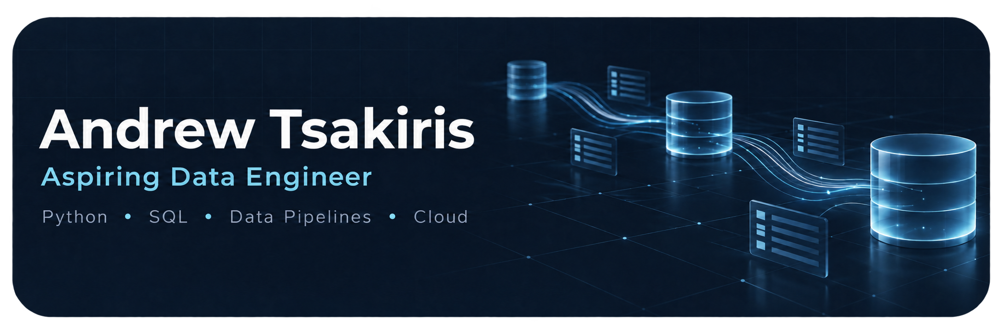

 

# Andrew Tsakiris

---

## About

I'm an aspiring **Data Engineer** and student based in **Athens, Greece**, focused on building scalable data pipelines, analytics systems, and data-driven applications.

I work primarily with **Python, SQL, PostgreSQL, PySpark, Apache Airflow, Docker, and AWS**, building ETL/ELT pipelines and processing large datasets. I also have experience building **web applications, SaaS products, and AI-powered tools**.

- Student & developer based in **Athens, Greece**
- Focused on **Data Engineering & Backend Development**
- Building **ETL pipelines, analytics systems, and data-driven applications**
- Open to collaborating on interesting projects
- Contact: andrew07_02@outlook.com

---

## What I Ship

**Data & Analytics**  
ETL/ELT pipelines, data processing systems, analytical databases, and dashboards built around real-world datasets.

**Backend & APIs**  
Scalable backend services and REST APIs using Python, FastAPI, Node.js, and PostgreSQL.

**AI & Automation**  
AI-powered applications and automation workflows designed to solve practical problems.

**Web Applications**  
Modern web applications with a focus on performance, usability, and maintainable architecture.

---

## Tech Stack

| Category | Technologies |
|---|---|
| **Data Engineering** | Python, SQL, PySpark, Apache Airflow, ETL/ELT |
| **Databases** | PostgreSQL, SQLAlchemy, Supabase |
| **Backend** | FastAPI, Node.js, Express |
| **Cloud & DevOps** | AWS, Docker, CI/CD |
| **Analytics** | Streamlit, Plotly, Pandas |
| **Frontend** | React, Next.js, TypeScript, Tailwind CSS |
| **AI & Automation** | Claude API, n8n, Webhooks |

---

## What I Value

- **Shipping over perfection** — Build, deploy, learn, improve
- **Real-world projects** — Focus on practical applications and useful systems
- **Scalable design** — Build systems that can grow with demand
- **Continuous learning** — Always improving my engineering skills
- **Clear communication** — Simple, maintainable, and understandable code

---

**Last updated:** September 2026
